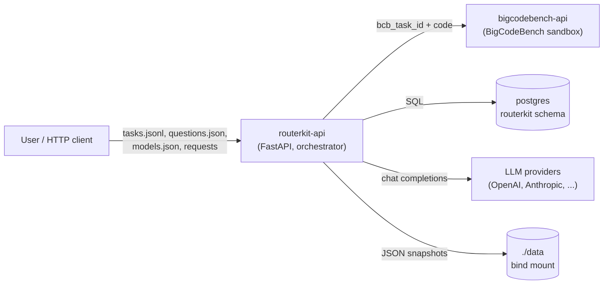
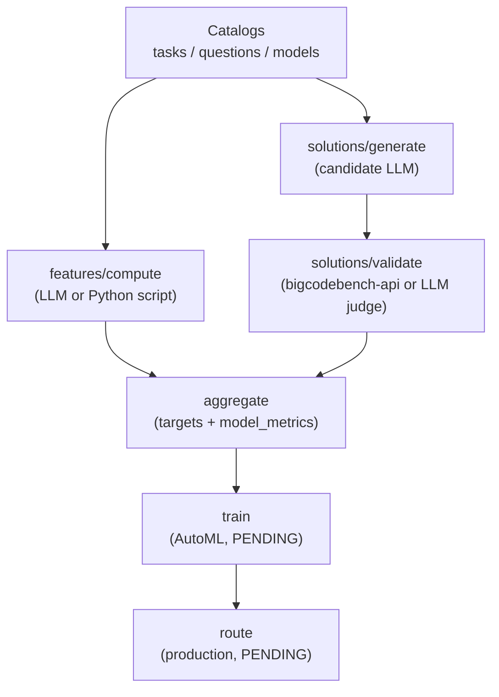

# RouterKit

**RouterKit** is a platform for training and serving an LLM *router* for programming tasks: given a catalog of coding tasks, it generates solutions with different candidate LLMs, evaluates them (real tests via [BigCodeBench](https://github.com/bigcode-project/bigcodebench) or an LLM judge), aggregates the results as a training dataset, and (eventually) trains a predictor that picks, in production, which LLM is best suited for a new task, balancing quality vs. cost.

> **Status**: the data pipeline (catalogs → features → generation → evaluation → aggregation) is complete and functional. Predictor training (AutoML), the production routing policy, and result export are **not implemented yet** — see [Current status and roadmap](#current-status-and-roadmap).

## Table of contents

- [Architecture](#architecture)
- [Quick start](#quick-start)
- [Key concepts](#key-concepts)
- [End-to-end pipeline](#end-to-end-pipeline)
- [Data model](#data-model)
- [Configuration](#configuration)
- [Repo structure](#repo-structure)
- [Current status and roadmap](#current-status-and-roadmap)

## Architecture

Three services orchestrated with `docker-compose`:



- **`routerkit-api`**: FastAPI. Owns all the business logic and the Postgres schema. The only HTTP entry point for the user.
- **`bigcodebench-api`**: a thin HTTP wrapper around the `bigcodebench` package (official `bigcodebench/bigcodebench-evaluate` image). Runs `untrusted_check` (the real sandbox, with resource limits) for a single `(bcb_task_id, solution)` at a time, via a job/polling pattern. No port published to the host: only reachable from `routerkit-api`, over the internal network.
- **`postgres`**: a single `routerkit` schema. No "experiment" concept: the whole system always operates on **what's active** (see [Key concepts](#key-concepts)).

## Quick start

```bash
cp .env.example .env
# fill in at least one API key (OPENAI_API_KEY, ANTHROPIC_API_KEY, ...)

docker compose up --build
```

On startup, `routerkit-api` runs against Postgres and exposes `http://localhost:8000` (Swagger UI at `/docs`). The first time the database is empty, it **automatically preloads the official BigCodeBench catalog** (1135 tasks — the full dataset has 1140, but 5 were excluded because their tests depend on web pages that no longer exist, see [`data/examples/tasks_exp.jsonl`](data/examples/tasks_exp.jsonl)) — no manual step is needed to have tasks available.

To start generating and evaluating solutions you also need to load feature questions and candidate models:

```bash
curl -X POST localhost:8000/questions/import -F file=@data/examples/questions.json
curl -X POST localhost:8000/models/import     -F file=@data/examples/models.json
```

And optionally replace the task catalog with your own (custom, official benchmark, or mixed — see [`TaskImportRow`](routerkit-api/app/schemas.py)):

```bash
curl -X POST localhost:8000/tasks/import -F file=@data/examples/tasks.jsonl
```

### `data/examples/`

There's one example file per upload the system accepts, and all of them travel as `.jsonl` (one JSON row per line) via `multipart` — `tasks.jsonl`, `questions.json`†, `models.json`†, and `features.jsonl`, `solutions.jsonl`, `validations.jsonl` for `type=load` of `/features/compute`, `/solutions/generate`, and `/solutions/validate` respectively (`type` and the rest of the parameters go as query params, not in the body — see the example `curl` below):

```bash
curl -X POST "localhost:8000/solutions/generate?type=load" -F file=@data/examples/solutions.jsonl
curl -X POST "localhost:8000/solutions/validate?type=load" -F file=@data/examples/validations.jsonl
```

† `questions.json`/`models.json` are the exception: they stay a single JSON object (`{"questions": [...]}` / `{"models": [...]}`), because they're small catalogs (dozens of rows) where JSONL's scalability isn't needed — unlike `tasks`/`features`/`solutions`/`validations`, which in a real run scale to thousands of rows.

Tasks in `type=load` files are identified by `bcb_task_id` (benchmark) or `custom_task_id` (custom) — never by the internal Postgres `task_id`, which isn't stable across reloads. `question_id`/`model_name` need to match the real ones that exist in your database at the time you load them.

Full field-by-field guide for each file (allowed values, which ones are required, how to build your own `*_exp`): [`data/examples/README.md`](data/examples/README.md).

The `*_exp.json`/`*_exp.jsonl` files (e.g. `tasks_exp.jsonl`, `questions_exp.json`) are, instead, the actual data used in the experiment (not a minimal example) — `tasks_exp.jsonl` is the complete BigCodeBench dataset (the same one that's preloaded at startup); the others get added by the team as the experiment runs.

## Key concepts

- **No "experiments" table**: there are no parallel runs or experiment-based scoping. Every catalog reload (tasks/questions/models) or recomputation (features/solutions/grades/targets/model_metrics) always follows the same pattern: **deactivate the old, activate the new** (`active BOOLEAN`, logical deletion). When a "source" row is deactivated (a task, a model), the deactivation cascades to everything computed from it (see [`app/services/cascade.py`](routerkit-api/app/services/cascade.py)). No historical-read endpoint exists on purpose — to see deactivated data, you query Postgres directly.
- **Long-running processes = persisted async jobs**: `features/compute`, `solutions/generate`, and `solutions/validate` run in the background (Postgres, not in memory — they survive a container restart) and return 202 instantly. `GET /jobs` shows the active row's status for each kind (`empty` | `running` | `idle` with `last_result`), in a single request. 409 if a job of that same kind is already running.
- **Concurrency bounded per model**: each `model.concurrency` limits how many calls to THAT model can be in flight at once (`ThreadPoolExecutor`, see [`app/services/concurrency.py`](routerkit-api/app/services/concurrency.py)). The one exception is evaluation against `bigcodebench-api`, which deliberately runs **sequentially** (it's already a background job; there's no point parallelizing against a service that already has its own internal limit).
- **Logprob-calibrated probability, only where it applies**: LLM features (`kind=binary`/`numeric`) use `exp(logprob)` of the response's first token to get a calibrated probability instead of a plain yes/no. The LLM judge (`services/judge.py`), by contrast, is purely binary (`passed: bool`) — no logprobs, no probability — same as the verdict from `bigcodebench-api`.
- **Explicit `has_error`**: in `solutions` and `grades`, an infrastructure failure (the LLM call failed, `bigcodebench-api` didn't respond, timeout) is flagged with `has_error=true`, **distinct** from a legitimate negative result (`passed=false`, with its `fail_reason`). Neither one aborts the rest of the batch being processed.
- **Snapshots on disk**: every reload/recomputation leaves a JSON with the resulting active state at `data/current/<name>.json`, rotating the previous one to `data/previous/<name>.json` (a single step back, not a full history). `./data` is a bind mount (not a named Docker volume), so it's visible/editable directly from the host.

## End-to-end pipeline



| Step | Endpoint | Async | Description |
|---|---|:-:|---|
| Catalogs | `POST /tasks/import`, `/questions/import`, `/models/import` | No | Replaces (logical delete) the corresponding catalog, via a `multipart` file. |
| Features | `POST /features/compute` | Yes | `type=calculate`: for ALL active tasks × questions, questions with `script` → local Python, without `script` → the single active `role=feature` model. `type=load`: inserts features already computed externally. |
| Generation | `POST /solutions/generate` | Yes | `type=calculate`: generates with ALL active `role=candidate` models, `n_samples` per task. `type=load`: inserts solutions already computed externally. |
| Evaluation | `POST /solutions/validate` | Yes | Groups active solutions by `task.bcb_task_id`: with a value → `bigcodebench-api` (sequential); without one → the single active `role=judge` model (concurrent). `type=load` also available. |
| Aggregation | `POST /aggregate` | No | Recomputes `targets` (pass_rate per task+model) and `model_metrics` (aggregated per model) from active solutions/grades. |
| Training | `POST /train` | No | **Stub** (501) — see roadmap. |
| Routing | `POST /route` | No | **Stub** (501) — see roadmap. |
| Jobs | `GET /jobs` | — | Status of the active row for each known async job kind. |

All import/compute/generation/evaluation endpoints are **bulk-only**: there are no "single record" equivalents (e.g. there's no `POST /solutions/{id}/evaluate`) — every process identifies on its own which active rows it needs to process.

## Data model

A single Postgres schema (`routerkit`), with no experiments table:

```
tasks ──┬──> features <── questions
        ├──> solutions ──> grades
        └──> targets <──────────────┐
models ─┼──> solutions               │
        ├──> targets ────────────────┤
        └──> model_metrics <── (aggregated from targets + solutions)

targets + features ──> predictors ──> route_decisions
```

- **`tasks`**: `bcb_task_id` decides the type *per row*: with a value (`"BigCodeBench/12"`) it's an official benchmark task (evaluated 100% inside `bigcodebench-api`); without one it's custom (evaluated with the LLM judge). `custom_task_id` is the equivalent stable key for custom tasks (assigned by the user) — none of the `type=load` paths ever reference the internal Postgres `task_id`, which isn't stable across reloads.
- **`questions`**: feature questions, `kind=binary|numeric`; with `script` they're resolved locally in Python (cost 0), without `script` via LLM. `question_key` is their stable key (assigned by the user) to reference them from `features` `type=load`.
- **`models`**: `role=candidate` (generates/routes solutions, several can be active at once with distinct `name`), `feature` or `judge` (at most one active of each).
- **`solutions`** / **`grades`**: 1 row per generation attempt / its verdict (1:1 relationship).
- **`targets`** / **`model_metrics`**: aggregates fully recomputed on every `POST /aggregate`.
- **`predictors`** / **`route_decisions`**: destination of training and of production routing (not populated yet — see roadmap).
- **`jobs`**: tracking of async processes (persisted in Postgres, not in memory).

The complete DDL, with the reasoning behind each decision documented inline, is in [`postgres/init/001_schema.sql`](postgres/init/001_schema.sql).

## Configuration

Environment variables (`.env`, see [`.env.example`](.env.example)):

| Variable | Use |
|---|---|
| `POSTGRES_USER` / `POSTGRES_PASSWORD` / `POSTGRES_DB` | Postgres credentials. |
| `OPENAI_API_KEY`, `ANTHROPIC_API_KEY`, `AZURE_OPENAI_API_KEY` (+ `AZURE_OPENAI_API_VERSION`), `OPENROUTER_API_KEY`, `CUSTOM_LLM_API_KEY` | Fixed key convention per `provider`. |
| `OPENAI_API_KEY_2`, etc. | Additional accounts for the same provider — each `model` in `models.json` can point to its own variable via `api_key_env`. |

`routerkit-api` resolves provider/deployment/temperature/timeout/concurrency per `models` row (via [`litellm`](https://github.com/BerriAI/litellm)), not per request — see the example in [`data/examples/models.json`](data/examples/models.json).

## Repo structure

```
routerkit/
├── docker-compose.yml
├── .env.example
├── postgres/
│   └── init/001_schema.sql        # full, commented DDL
├── bigcodebench-api/
│   ├── Dockerfile                 # FROM bigcodebench/bigcodebench-evaluate
│   └── app/
│       ├── main.py                # POST /jobs, GET /jobs/{id}
│       ├── jobs.py                # in-memory jobs + threadpool
│       ├── evaluator.py           # get_bigcodebench() + untrusted_check()
│       └── schemas.py
├── routerkit-api/
│   └── app/
│       ├── main.py                # lifespan: job reset + task seeding
│       ├── config.py
│       ├── schemas.py             # *ImportRow (tasks/questions/models)
│       ├── db/
│       │   ├── base.py
│       │   └── models.py          # ORM 1:1 with the SQL schema
│       ├── clients/
│       │   ├── llm_client.py      # litellm + normalize_yes_no/logprobs
│       │   └── bigcodebench_client.py
│       ├── routers/                # catalogs, features, solutions,
│       │   ...                     # evaluation, aggregation, training,
│       │   ...                     # routing, jobs
│       └── services/
│           ├── cascade.py          # cascading logical deletion
│           ├── concurrency.py      # run_bounded (ThreadPoolExecutor)
│           ├── jobs.py             # async jobs persisted in Postgres
│           ├── snapshots.py        # data/current + data/previous
│           ├── seed.py             # preloads tasks_exp.jsonl at startup
│           ├── tasks_catalog.py    # task replacement (import + seed)
│           ├── features_llm.py / features_python.py
│           ├── generation.py       # solution generation
│           ├── judge.py            # LLM judge (custom tasks)
│           ├── aggregation.py      # targets + model_metrics
│           └── training.py         # STUB
└── data/
    ├── examples/                   # one minimal example per upload, plus
    │                                # the real *_exp.json(l) experiment data
    ├── current/                    # current snapshots (runtime, gitignored)
    └── previous/                   # previous snapshot (runtime, gitignored)
```

## Current status and roadmap

**Complete and functional**: catalogs (with automatic preloading of the official benchmark), features (LLM + Python), solution generation, evaluation (bigcodebench-api + LLM judge), targets/model_metrics aggregation, async jobs.

**Pending** (what's next):

- **Predictor training** (`services/training.py`, `POST /train`): build the long-format dataset from active `features`/`targets`, choose/run AutoML, serialize the artifact under `ARTIFACTS_DIR`, and register the `predictor` in Postgres.
- **Production routing policy** (`services/routing.py` — doesn't exist yet, today it lives as a stub inside `routers/routing.py`, `POST /route`): compute live features for a new prompt, score each candidate with the production predictor, and pick a winner balancing quality vs. cost (λ, `p_min`, exclusions, fallback — parameters not defined yet).
- **Result export**: there's no format/endpoint defined yet to export the training dataset or routing results out of the system.
