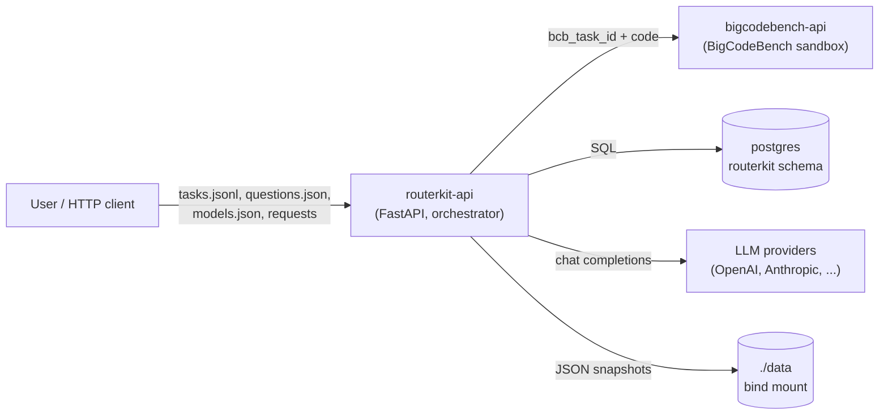
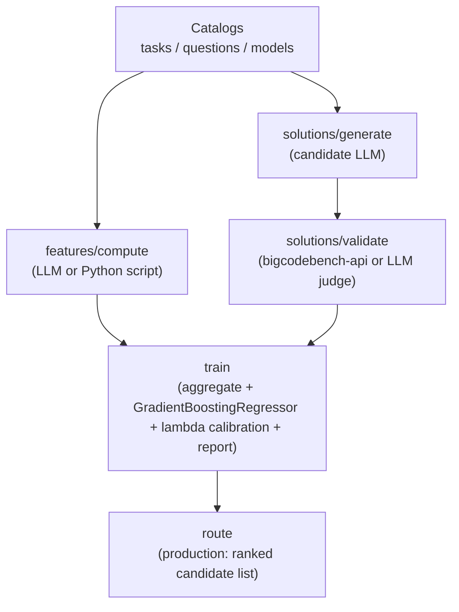

# RouterKit

**RouterKit** is a platform for training and serving an LLM *router* for programming tasks: given a catalog of coding tasks, it generates solutions with different candidate LLMs, evaluates them (real tests via [BigCodeBench](https://github.com/bigcode-project/bigcodebench) or an LLM judge), aggregates the results as a training dataset, trains a predictor that picks which LLM is best suited for a new task (balancing quality vs. cost), and serves that predictor in production via `POST /route`.

> **Status**: the full pipeline is complete and functional end to end — catalogs → features → generation → evaluation → aggregation → training (with automatic routing-lambda calibration) → production routing. Every `POST /train` also writes a human-readable report (charts + data) of the freshly trained predictor and its routing calibration — see [Training report](#training-report). An automated test suite is planned for a future release; see [Current status and roadmap](#current-status-and-roadmap).

## Table of contents

- [Architecture](#architecture)
- [Quick start](#quick-start)
- [Key concepts](#key-concepts)
- [End-to-end pipeline](#end-to-end-pipeline)
- [Training report](#training-report)
- [Data model](#data-model)
- [Configuration](#configuration)
- [Repo structure](#repo-structure)
- [Current status and roadmap](#current-status-and-roadmap)
- [License](#license)

## Architecture

Three services orchestrated with `docker-compose`:



- **`routerkit-api`**: FastAPI. Owns all the business logic and the Postgres schema. The only HTTP entry point for the user.
- **`bigcodebench-api`**: a thin HTTP wrapper around the `bigcodebench` package (official `bigcodebench/bigcodebench-evaluate` image). Runs `untrusted_check` (the real sandbox, with resource limits) for a single `(bcb_task_id, solution)` at a time, via a job/polling pattern. No port published to the host: only reachable from `routerkit-api`, over the internal network.
- **`postgres`**: a single `routerkit` schema. No "experiment" concept: the whole system always operates on **what's active** (see [Key concepts](#key-concepts)).

## Quick start

```bash
cp .env.example .env
# fill in at least one API key (OPENAI_API_KEY, ANTHROPIC_API_KEY, ...)

docker compose up --build
```

On startup, `routerkit-api` runs against Postgres and exposes `http://localhost:8000` (Swagger UI at `/docs`). The first time the database is empty, it **automatically preloads the official BigCodeBench catalog** (1128 tasks — the full dataset has 1140, but 12 were excluded: 5 because their tests depend on web pages that no longer exist, and 7 because grading them disagreed between bigcodebench-evaluate image versions, see [`data/examples/tasks_exp.jsonl`](data/examples/tasks_exp.jsonl) and `app/services/seed.py`) — no manual step is needed to have tasks available.

To start generating and evaluating solutions you also need to load feature questions and candidate models:

```bash
curl -X POST localhost:8000/questions/import -F file=@data/examples/questions.json
curl -X POST localhost:8000/models/import     -F file=@data/examples/models.json
```

And optionally replace the task catalog with your own (custom, official benchmark, or mixed — see [`TaskImportRow`](routerkit-api/app/schemas.py)):

```bash
curl -X POST localhost:8000/tasks/import -F file=@data/examples/tasks.jsonl
```

Once you have active `features`/`solutions`/`grades` (computed live or loaded via `type=load`, see below), train a predictor and route a prompt with it:

```bash
curl -X POST localhost:8000/train          # 202, poll GET /jobs for progress
curl -X POST localhost:8000/route -H "Content-Type: application/json" \
     -d '{"prompt": "Write a function that reverses a string"}'
```

`POST /train` also writes a report (charts + data) to `data/current/report/` — see [Training report](#training-report).

### Easiest path: `scripts/`

The above is the manual, step-by-step version. If you're installing for the first time or aren't sure which commands you need, start with the interactive wizard. It asks every decision up front (reproduce the experiment, a custom run with your own catalogs or live LLM calls, retrain, or try the router on prompts), then checks what those answers need: Python 3.10+, Docker running with Compose v2, enough free disk space (~20 GB on the first install), the experiment datasets, and the API keys/endpoints of any model that will be called live, offering to fill in missing keys (saved to `.env`) and `<...>` placeholders (saved to a gitignored `*.local.json` copy of the models file). Finally it shows the exact commands below that fit your answers and runs them step by step with live progress:

```bash
python scripts/wizard.py
```

For the common case — stand everything up and reproduce the real experiment, with zero LLM cost — two Python scripts (stdlib only, no `pip install` needed) do it in two commands:

```bash
python scripts/start.py          # downloads the heavy datasets if missing, brings up docker-compose, waits for the API
python scripts/run_pipeline.py   # loads the real experiment's catalogs/data (type=load) and trains a predictor
```

`run_pipeline.py` stops at the **first** error of any kind, anywhere (even a single failed row in an otherwise-successful batch) — it's meant to surface every problem for you to look at, not decide on its own what's safe to ignore. Once you've fixed whatever it reported, resume without repeating earlier steps with `--start-from=<step>` (e.g. `--start-from=solutions`). To use your own catalogs/data instead of the experiment's, or to actually call LLMs instead of loading precomputed results, see `python scripts/run_pipeline.py --help` — every option is documented there, not duplicated here.

### `data/examples/`

There's one example file per upload the system accepts, and all of them travel as `.jsonl` (one JSON row per line) via `multipart` — `tasks.jsonl`, `questions.json`†, `models.json`†, and `features.jsonl`, `solutions.jsonl`, `validations.jsonl` for `type=load` of `/features/compute`, `/solutions/generate`, and `/solutions/validate` respectively (`type` and the rest of the parameters go as query params, not in the body — see the example `curl` below):

```bash
curl -X POST "localhost:8000/solutions/generate?type=load" -F file=@data/examples/solutions.jsonl
curl -X POST "localhost:8000/solutions/validate?type=load" -F file=@data/examples/validations.jsonl
```

† `questions.json`/`models.json` are the exception: they stay a single JSON object (`{"questions": [...]}` / `{"models": [...]}`), because they're small catalogs (dozens of rows) where JSONL's scalability isn't needed — unlike `tasks`/`features`/`solutions`/`validations`, which in a real run scale to thousands of rows.

Tasks in `type=load` files are identified by `bcb_task_id` (benchmark) or `custom_task_id` (custom) — never by the internal Postgres `task_id`, which isn't stable across reloads. `question_id`/`model_name` need to match the real ones that exist in your database at the time you load them.

Full field-by-field guide for each file (allowed values, which ones are required, how to build your own `*_exp`): [`data/examples/README.md`](data/examples/README.md).

The `*_exp.json`/`*_exp.jsonl` files (e.g. `tasks_exp.jsonl`, `questions_exp.json`) are, instead, the actual data used in the experiment (not a minimal example) — `tasks_exp.jsonl` is the complete BigCodeBench dataset (the same one that's preloaded at startup); the others get added by the team as the experiment runs.

Two of those (`solutions_exp.jsonl`, `validations_exp.jsonl`) are hundreds of MB and aren't part of `git clone` — download them from the repo's [GitHub Releases](https://github.com/Timia-Group/routerkit/releases) page instead (see [`data/examples/README.md`](data/examples/README.md#downloading-solutions_expjsonl--validations_expjsonl) for the exact commands).

## Key concepts

- **No "experiments" table**: there are no parallel runs or experiment-based scoping. Every catalog reload (tasks/questions/models) or recomputation (features/solutions/grades/targets/model_metrics) always follows the same pattern: **deactivate the old, activate the new** (`active BOOLEAN`, logical deletion). When a "source" row is deactivated (a task, a model), the deactivation cascades to everything computed from it (see [`app/services/cascade.py`](routerkit-api/app/services/cascade.py)). No historical-read endpoint exists on purpose — to see deactivated data, you query Postgres directly.
- **Long-running processes = persisted async jobs**: `features/compute`, `solutions/generate`, and `solutions/validate` run in the background (Postgres, not in memory — they survive a container restart) and return 202 instantly. `GET /jobs` shows the active row's status for each kind (`empty` | `running` | `idle` with `last_result`), in a single request. 409 if a job of that same kind is already running.
- **Concurrency bounded per model**: each `model.concurrency` limits how many calls to THAT model can be in flight at once (`ThreadPoolExecutor`, see [`app/services/concurrency.py`](routerkit-api/app/services/concurrency.py)). The one exception is evaluation against `bigcodebench-api`, which deliberately runs **sequentially** (it's already a background job; there's no point parallelizing against a service that already has its own internal limit).
- **Logprob-calibrated probability, only where it applies**: LLM features (`kind=binary`/`numeric`) use `exp(logprob)` of the response's first token to get a calibrated probability instead of a plain yes/no. The LLM judge (`services/judge.py`), by contrast, is purely binary (`passed: bool`) — no logprobs, no probability — same as the verdict from `bigcodebench-api`.
- **Explicit `has_error`**: in `solutions` and `grades`, an infrastructure failure (the LLM call failed, `bigcodebench-api` didn't respond, timeout) is flagged with `has_error=true`, **distinct** from a legitimate negative result (`passed=false`, with its `fail_reason`). Neither one aborts the rest of the batch being processed.
- **Snapshots on disk**: every reload/recomputation leaves a JSON with the resulting active state at `data/current/<name>.json`, rotating the previous one to `data/previous/<name>.json` (a single step back, not a full history). `./data` is a bind mount (not a named Docker volume), so it's visible/editable directly from the host.
- **Routing policy = `score = Y_pred − λ · cost/cost_max`**: `Y_pred` is the trained predictor's output, `cost` each candidate's average cost per real attempt. `λ` isn't a parameter the user sets — it's calibrated automatically at training time (`services/routing_calibration.py`) via Monte Carlo simulation (bootstrap-resampling real historical pass/fail outcomes, not synthetic draws) over a lambda grid, picking the "elbow" of the resulting (cost, accuracy) curve with [`kneed`](https://github.com/arvkevi/kneed). `POST /route` always uses the lambda calibrated for the full retry budget (`MAX_SHOTS = 3`) to score every active candidate in one pass, returning them all ranked — not a different lambda per shot, and not an interactive "tell me what you already tried" loop.
- **LLM calls retry, then circuit-break, per model**: a rate-limit or connection error is retried automatically (up to 3 times, exponential backoff) before counting as a real failure (see [`app/clients/llm_client.py`](routerkit-api/app/clients/llm_client.py)). If the *same* model still fails 3 times in a row even after retries, it's assumed to be down for now — the rest of that model's not-yet-started work in the current batch is skipped (not attempted) instead of each item waiting out the same retries to confirm it again (see `circuit_breaker` in [`app/services/concurrency.py`](routerkit-api/app/services/concurrency.py)). Scoped per model: another model having an outage never affects this one.

## End-to-end pipeline



| Step | Endpoint | Async | Description |
|---|---|:-:|---|
| Catalogs | `POST /tasks/import`, `/questions/import`, `/models/import` | No | Replaces (logical delete) the corresponding catalog, via a `multipart` file. |
| Features | `POST /features/compute` | Yes | `type=calculate`: for ALL active tasks × questions, questions with `script` → local Python, without `script` → the single active `role=feature` model. `type=load`: inserts features already computed externally. |
| Generation | `POST /solutions/generate` | Yes | `type=calculate`: generates with ALL active `role=candidate` models, `n_samples` per task. `type=load`: inserts solutions already computed externally. |
| Evaluation | `POST /solutions/validate` | Yes | Groups active solutions by `task.bcb_task_id`: with a value → `bigcodebench-api` (sequential); without one → the single active `role=judge` model (concurrent). `type=load` also available. |
| Training | `POST /train` | Yes | Recomputes `targets`/`model_metrics` from active solutions/grades, builds the dataset from active features/targets, trains `GradientBoostingRegressor` (`GridSearchCV` + `GroupKFold`, grouped by task so a task never leaks across train/test), calibrates the routing lambda for 1..`MAX_SHOTS` attempts (Monte Carlo + automatic elbow detection), persists the predictor (replacing the previous active one), and writes the [training report](#training-report). Progress via `GET /jobs`. There's no standalone aggregation endpoint — this is the only place `targets`/`model_metrics` get recomputed. |
| Routing | `POST /route` | No | Takes a `prompt`, computes its features live (LLM/script, concurrent), scores every active candidate with the active predictor and the lambda calibrated for the full shot budget, and returns them **all, ranked best first** — the caller executes them in that order until one succeeds. Every decision is recorded in `route_decisions`. 409 if no active predictor exists yet (`POST /train` first). |
| Jobs | `GET /jobs` | — | Status of the active row for each known async job kind. |

All import/compute/generation/evaluation endpoints are **bulk-only**: there are no "single record" equivalents (e.g. there's no `POST /solutions/{id}/evaluate`) — every process identifies on its own which active rows it needs to process.

## Training report

Every `POST /train` writes a report to `data/current/report/` (rotating the previous one to `data/previous/report/`, same convention as the catalog snapshots) — meant for a human to open directly from disk, no server needed:

| File | What it shows |
|---|---|
| `sankey.html` / `.png` | For the production lambda (the one calibrated for the full shot budget), where each test task's attempts actually go — shot 1 → shot 2 → shot 3, stopping as soon as one succeeds (one reproducible Monte Carlo realization, not an aggregate). |
| `sensitivity_table.html` / `.png` | % of tasks solved and accumulated cost, for a curated set of lambda values × shot budget (1/2/3), on the test split — highlights the best accuracy per column. |
| `frontier.html` / `.png` | Cost vs. quality at the production shot budget: the router's point against each candidate model used entirely on its own. |
| `tradeoff_curve.html` / `.png` | The full lambda grid swept on the test split, one curve per shot budget, with a marker (★) at the lambda actually chosen for each — chosen on a *separate* sweep over the train split, so it doesn't have to land exactly on this curve's own peak (see the chart's own caption). |
| `lambda_grid.html` / `.png` | For a sample of test tasks, which model shot 1 would actually go to as lambda sweeps from 0 to 4 — illustrates the router dropping the most-capable-but-priciest candidate as the cost penalty grows. |

Each chart also has a `.csv` with its underlying data, and `index.html` links all of them. Every chart is built strictly from this project's own data (real solutions/grades + the freshly trained predictor) — nothing is copied from any reference experiment, even where the chart types mirror one for easy side-by-side comparison.

## Data model

A single Postgres schema (`routerkit`), with no experiments table:

```
tasks ──┬──> features <── questions
        ├──> solutions ──> grades
        └──> targets <──────────────┐
models ─┼──> solutions               │
        ├──> targets ────────────────┤
        └──> model_metrics <── (aggregated from targets + solutions)

targets + features ──> predictors ──> route_decisions
```

- **`tasks`**: `bcb_task_id` decides the type *per row*: with a value (`"BigCodeBench/12"`) it's an official benchmark task (evaluated 100% inside `bigcodebench-api`); without one it's custom (evaluated with the LLM judge). `custom_task_id` is the equivalent stable key for custom tasks (assigned by the user) — none of the `type=load` paths ever reference the internal Postgres `task_id`, which isn't stable across reloads.
- **`questions`**: feature questions, `kind=binary|numeric`; with `script` they're resolved locally in Python (cost 0), without `script` via LLM. `question_key` is their stable key (assigned by the user) to reference them from `features` `type=load`.
- **`models`**: `role=candidate` (generates/routes solutions, several can be active at once with distinct `name`), `feature` or `judge` (at most one active of each).
- **`solutions`** / **`grades`**: 1 row per generation attempt / its verdict (1:1 relationship).
- **`targets`** / **`model_metrics`**: aggregates fully recomputed at the start of every `POST /train` (no standalone aggregation endpoint).
- **`predictors`**: one row per `POST /train` run — the serialized model's path (`artifact_path`), the feature-column contract (`feature_columns`), and the calibrated routing lambdas (`routing_lambdas`/`lambda_sweep`). Only one is ever `active` (full replace, same pattern as the rest of the system) — that's always the one `POST /route` uses.
- **`route_decisions`**: one row per `POST /route` call — the live-computed features, the full ranking returned, and which predictor produced it. Written whether or not the caller ever follows up on the recommendation.
- **`jobs`**: tracking of async processes (persisted in Postgres, not in memory).

The complete DDL, with the reasoning behind each decision documented inline, is in [`postgres/init/001_schema.sql`](postgres/init/001_schema.sql).

## Configuration

Environment variables (`.env`, see [`.env.example`](.env.example)):

| Variable | Use |
|---|---|
| `POSTGRES_USER` / `POSTGRES_PASSWORD` / `POSTGRES_DB` | Postgres credentials. |
| `OPENAI_API_KEY`, `ANTHROPIC_API_KEY`, `AZURE_OPENAI_API_KEY` (+ `AZURE_OPENAI_API_VERSION`), `OPENROUTER_API_KEY`, `CUSTOM_LLM_API_KEY` | Fixed key convention per `provider`. |
| `OPENAI_API_KEY_2`, etc. | Additional accounts for the same provider — each `model` in `models.json` can point to its own variable via `api_key_env`. |

`routerkit-api` resolves provider/deployment/temperature/timeout/concurrency per `models` row (via [`litellm`](https://github.com/BerriAI/litellm)), not per request — see the example in [`data/examples/models.json`](data/examples/models.json).

## Repo structure

```
routerkit/
├── docker-compose.yml
├── .env.example
├── scripts/
│   ├── wizard.py                  # interactive guide: asks, then runs the scripts below
│   ├── start.py                   # downloads datasets, docker compose up, waits for the API
│   ├── run_pipeline.py            # runs the full pipeline end to end (see Quick start)
│   └── test_route.py              # calls POST /route with one prompt, prints the ranking
├── postgres/
│   └── init/001_schema.sql        # full, commented DDL
├── bigcodebench-api/
│   ├── Dockerfile                 # FROM bigcodebench/bigcodebench-evaluate
│   └── app/
│       ├── main.py                # POST /jobs, GET /jobs/{id}
│       ├── jobs.py                # in-memory jobs + threadpool
│       ├── evaluator.py           # get_bigcodebench() + untrusted_check()
│       └── schemas.py
├── routerkit-api/
│   └── app/
│       ├── main.py                # lifespan: job reset + task seeding
│       ├── config.py
│       ├── schemas.py             # *ImportRow (tasks/questions/models)
│       ├── db/
│       │   ├── base.py
│       │   └── models.py          # ORM 1:1 with the SQL schema
│       ├── clients/
│       │   ├── llm_client.py      # litellm + normalize_yes_no/logprobs
│       │   └── bigcodebench_client.py
│       ├── routers/                # catalogs, features, solutions,
│       │   ...                     # evaluation, training, routing, jobs
│       └── services/
│           ├── cascade.py          # cascading logical deletion
│           ├── concurrency.py      # run_bounded (ThreadPoolExecutor)
│           ├── jobs.py             # async jobs persisted in Postgres
│           ├── jsonl.py            # shared type=load parsing
│           ├── snapshots.py        # data/current + data/previous
│           ├── seed.py             # preloads tasks_exp.jsonl at startup
│           ├── tasks_catalog.py    # task replacement (import + seed)
│           ├── features_llm.py / features_python.py
│           ├── generation.py       # solution generation
│           ├── judge.py            # LLM judge (custom tasks)
│           ├── aggregation.py      # targets + model_metrics
│           ├── training.py         # dataset build + GridSearchCV training
│           ├── routing_calibration.py  # Monte Carlo lambda calibration
│           ├── policy.py           # score_and_select (production scoring)
│           └── reports.py          # training report (charts + CSVs)
└── data/
    ├── examples/                   # one minimal example per upload, plus
    │                                # the real *_exp.json(l) experiment data
    ├── predictors/                 # trained .joblib artifacts (runtime, gitignored)
    ├── current/                    # current snapshots + training report (runtime, gitignored)
    └── previous/                   # previous snapshot + report (runtime, gitignored)
```

## Current status and roadmap

**Complete and functional, end to end**: catalogs (with automatic preloading of the official benchmark), features (LLM + Python), solution generation, evaluation (bigcodebench-api + LLM judge), targets/model_metrics aggregation, async jobs, predictor training with automatic routing-lambda calibration, the training report, and production routing (`POST /route`).

**Deliberately out of scope for this release** (not gaps found during testing — decisions made to keep this release focused):

- **Automated test suite**: the system was validated through extensive manual/live testing against this project's own real dataset (see the [training report](#training-report)), not an automated regression suite — planned for a future release.
- **Result export**: there's no dedicated endpoint to export the training dataset or routing history as a file — `route_decisions` (every `POST /route` call) and the training report's CSVs already cover most of what that would do; a standalone export format can be added if a concrete need for one comes up.

## License

[Apache License 2.0](LICENSE).
