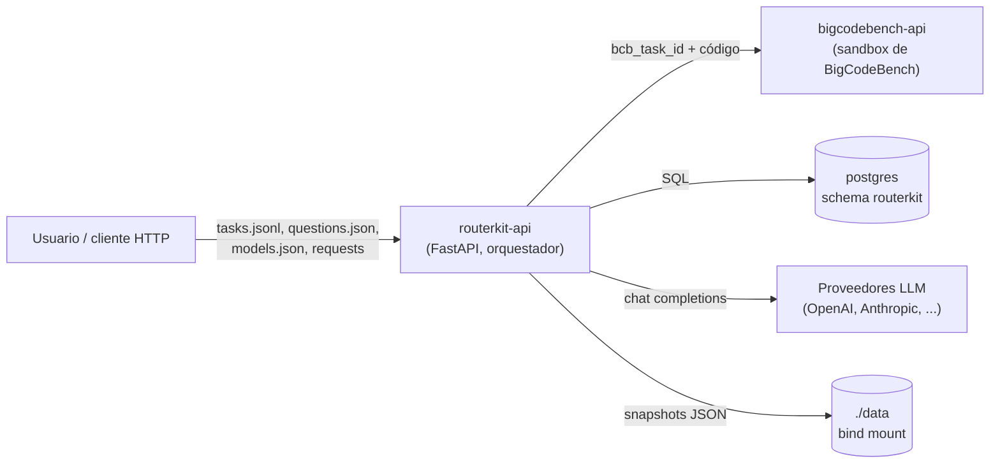
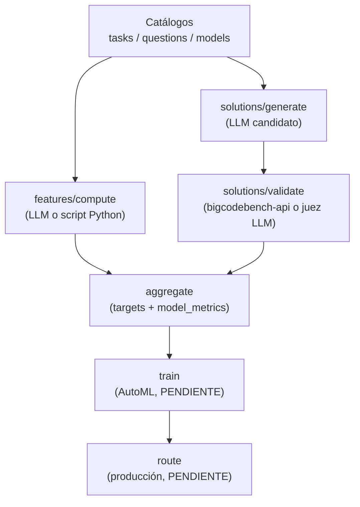

# RouterKit

**RouterKit** es una plataforma para entrenar y servir un *router* de LLMs para tareas de programación: dado un catálogo de tareas de código, genera soluciones con distintos LLMs candidatos, las evalúa (tests reales vía [BigCodeBench](https://github.com/bigcode-project/bigcodebench) o un juez LLM), agrega los resultados como dataset de entrenamiento, y (a futuro) entrena un predictor que elige en producción qué LLM conviene usar para una tarea nueva, balanceando calidad vs. costo.

> **Estado**: el pipeline de datos (catálogos → features → generación → evaluación → agregación) está completo y funcional. El entrenamiento del predictor (AutoML), la política de ruteo en producción y la exportación de resultados todavía **no están implementados** — ver [Estado actual y roadmap](#estado-actual-y-roadmap).

## Tabla de contenidos

- [Arquitectura](#arquitectura)
- [Quick start](#quick-start)
- [Conceptos clave](#conceptos-clave)
- [Pipeline end-to-end](#pipeline-end-to-end)
- [Modelo de datos](#modelo-de-datos)
- [Configuración](#configuración)
- [Estructura del repo](#estructura-del-repo)
- [Estado actual y roadmap](#estado-actual-y-roadmap)

## Arquitectura

Tres servicios orquestados con `docker-compose`:



- **`routerkit-api`**: FastAPI. Dueño de toda la lógica de negocio y del schema de Postgres. Único punto de entrada HTTP para el usuario.
- **`bigcodebench-api`**: wrapper HTTP fino sobre el paquete `bigcodebench` (imagen oficial `bigcodebench/bigcodebench-evaluate`). Corre `untrusted_check` (el sandbox real, con límites de recursos) para una sola `(bcb_task_id, solución)` a la vez, vía un patrón job/polling. Sin puerto publicado al host: solo accesible desde `routerkit-api`, por red interna.
- **`postgres`**: un único schema `routerkit`. No hay concepto de "experimento": todo el sistema opera siempre sobre **lo activo** (ver [Conceptos clave](#conceptos-clave)).

## Quick start

```bash
cp .env.example .env
# completar al menos una API key (OPENAI_API_KEY, ANTHROPIC_API_KEY, ...)

docker compose up --build
```

Al arrancar, `routerkit-api` corre sobre Postgres y expone `http://localhost:8000` (Swagger UI en `/docs`). La primera vez que la base de datos está vacía, **precarga automáticamente el catálogo oficial de BigCodeBench** (1140 tareas, ver [`data/seed/`](data/seed/)) — no hace falta ningún paso manual para tener tareas disponibles.

Para empezar a generar y evaluar soluciones hace falta además cargar preguntas de features y modelos candidatos:

```bash
curl -X POST localhost:8000/questions/import -F file=@data/examples/questions.json
curl -X POST localhost:8000/models/import     -F file=@data/examples/models.json
```

Y opcionalmente reemplazar el catálogo de tareas por uno propio (custom, benchmark oficial, o mezclado — ver [`TaskImportRow`](routerkit-api/app/schemas.py)):

```bash
curl -X POST localhost:8000/tasks/import -F file=@data/examples/tasks.jsonl
```

## Conceptos clave

- **Sin tabla de "experimentos"**: no hay corridas paralelas ni scoping por experimento. Cada recarga de un catálogo (tasks/questions/models) o recálculo (features/solutions/grades/targets/model_metrics) sigue siempre el mismo patrón: **desactivar lo anterior, activar lo nuevo** (`active BOOLEAN`, borrado lógico). Cuando se desactiva una fila "de origen" (una task, un model), la desactivación cae en cascada hacia todo lo que se calculó a partir de ella (ver [`app/services/cascade.py`](routerkit-api/app/services/cascade.py)). Ningún endpoint de lectura histórica existe a propósito — para ver datos desactivados, se consulta Postgres directo.
- **Procesos largos = jobs async persistidos**: `features/compute`, `solutions/generate` y `solutions/validate` corren en background (Postgres, no en memoria — sobreviven a un restart del container) y devuelven 202 al instante. `GET /jobs` muestra el estado de la fila activa de cada tipo (`empty` | `running` | `idle` con `last_result`), en un solo request. 409 si ya hay un job de ese mismo tipo corriendo.
- **Concurrencia acotada por modelo**: cada `model.concurrency` limita cuántas llamadas a ESE modelo pueden estar en vuelo a la vez (`ThreadPoolExecutor`, ver [`app/services/concurrency.py`](routerkit-api/app/services/concurrency.py)). La única excepción es la evaluación contra `bigcodebench-api`, que corre **secuencial** a propósito (ya es un job de fondo; no tiene sentido paralelizar contra un servicio que además ya tiene su propio límite interno).
- **Probabilidad calibrada vía logprobs, solo donde corresponde**: las features LLM (`kind=binary`/`numeric`) usan `exp(logprob)` del primer token de la respuesta para obtener una probabilidad calibrada en vez de un simple sí/no. El juez LLM (`services/judge.py`), en cambio, es puramente binario (`passed: bool`) — sin logprobs ni probabilidad — igual que el veredicto de `bigcodebench-api`.
- **`has_error` explícito**: en `solutions` y `grades`, un fallo de infraestructura (la llamada al LLM falló, `bigcodebench-api` no respondió, timeout) se marca con `has_error=true`, **distinto** de un resultado negativo legítimo (`passed=false`, con su `fail_reason`). Ninguno de los dos aborta el resto del lote que se estaba procesando.
- **Snapshots en disco**: cada recarga/recálculo deja un JSON con el estado activo resultante en `data/current/<nombre>.json`, rotando el anterior a `data/previous/<nombre>.json` (un solo paso atrás, no historial completo). `./data` es un bind mount (no un volumen Docker con nombre), así que es visible/editable directo desde el host.

## Pipeline end-to-end



| Paso | Endpoint | Async | Descripción |
|---|---|:-:|---|
| Catálogos | `POST /tasks/import`, `/questions/import`, `/models/import` | No | Reemplazo (borrado lógico) del catálogo correspondiente, vía archivo `multipart`. |
| Features | `POST /features/compute` | Sí | Para TODAS las tasks × questions activas: preguntas con `script` → Python local; sin `script` → el único model `role=feature` activo. |
| Generación | `POST /solutions/generate` | Sí | `type=calculate`: genera con TODOS los models `role=candidate` activos, `n_samples` por task. `type=load`: inserta soluciones ya calculadas afuera. |
| Evaluación | `POST /solutions/validate` | Sí | Agrupa las solutions activas por `task.bcb_task_id`: con valor → `bigcodebench-api` (secuencial); sin valor → el único model `role=judge` activo (concurrente). `type=load` también disponible. |
| Agregación | `POST /aggregate` | No | Recalcula `targets` (pass_rate por task+model) y `model_metrics` (agregado por model) a partir de solutions/grades activas. |
| Entrenamiento | `POST /train` | No | **Stub** (501) — ver roadmap. |
| Ruteo | `POST /route` | No | **Stub** (501) — ver roadmap. |
| Jobs | `GET /jobs` | — | Estado de la fila activa de cada job async conocido. |

Todos los endpoints de import/cómputo/generación/evaluación son **bulk-only**: no existen equivalentes de "un solo registro" (ej. no hay `POST /solutions/{id}/evaluate`) — todo proceso identifica por sí mismo qué filas activas tiene que procesar.

## Modelo de datos

Un único schema Postgres (`routerkit`), sin tabla de experimentos:

```
tasks ──┬──> features <── questions
        ├──> solutions ──> grades
        └──> targets <──────────────┐
models ─┼──> solutions               │
        ├──> targets ────────────────┤
        └──> model_metrics <── (agregado de targets + solutions)

targets + features ──> predictors ──> route_decisions
```

- **`tasks`**: `bcb_task_id` decide el tipo *por fila*: con valor (`"BigCodeBench/12"`) es una tarea oficial del benchmark (se evalúa 100% dentro de `bigcodebench-api`); sin valor es custom (se evalúa con el juez LLM).
- **`questions`**: preguntas de features, `kind=binary|numeric`; con `script` se resuelven en Python local (costo 0), sin `script` vía LLM.
- **`models`**: `role=candidate` (genera/rutea soluciones, pueden convivir varios activos con `name` distinto), `feature` o `judge` (a lo sumo uno activo de cada uno).
- **`solutions`** / **`grades`**: 1 fila por intento de generación / su veredicto (relación 1:1).
- **`targets`** / **`model_metrics`**: agregados recalculados por completo en cada `POST /aggregate`.
- **`predictors`** / **`route_decisions`**: destino del entrenamiento y del ruteo en producción (aún no poblados — ver roadmap).
- **`jobs`**: seguimiento de los procesos async (persistido en Postgres, no en memoria).

El DDL completo, con el razonamiento de cada decisión documentado inline, está en [`postgres/init/001_schema.sql`](postgres/init/001_schema.sql).

## Configuración

Variables de entorno (`.env`, ver [`.env.example`](.env.example)):

| Variable | Uso |
|---|---|
| `POSTGRES_USER` / `POSTGRES_PASSWORD` / `POSTGRES_DB` | Credenciales de Postgres. |
| `OPENAI_API_KEY`, `ANTHROPIC_API_KEY`, `AZURE_OPENAI_API_KEY` (+ `AZURE_OPENAI_API_VERSION`), `OPENROUTER_API_KEY`, `CUSTOM_LLM_API_KEY` | Convención fija de key por `provider`. |
| `OPENAI_API_KEY_2`, etc. | Cuentas adicionales del mismo proveedor — cada `model` en `models.json` puede apuntar a una variable propia vía `api_key_env`. |

`routerkit-api` resuelve el proveedor/deployment/temperatura/timeout/concurrencia por fila de `models` (vía [`litellm`](https://github.com/BerriAI/litellm)), no por request — ver el ejemplo en [`data/examples/models.json`](data/examples/models.json).

## Estructura del repo

```
routerkit/
├── docker-compose.yml
├── .env.example
├── postgres/
│   └── init/001_schema.sql        # DDL completo, comentado
├── bigcodebench-api/
│   ├── Dockerfile                 # FROM bigcodebench/bigcodebench-evaluate
│   └── app/
│       ├── main.py                # POST /jobs, GET /jobs/{id}
│       ├── jobs.py                # jobs en memoria + threadpool
│       ├── evaluator.py           # get_bigcodebench() + untrusted_check()
│       └── schemas.py
├── routerkit-api/
│   └── app/
│       ├── main.py                # lifespan: reset de jobs + seed de tasks
│       ├── config.py
│       ├── schemas.py             # *ImportRow (tasks/questions/models)
│       ├── db/
│       │   ├── base.py
│       │   └── models.py          # ORM 1:1 con el schema SQL
│       ├── clients/
│       │   ├── llm_client.py      # litellm + normalize_yes_no/logprobs
│       │   └── bigcodebench_client.py
│       ├── routers/                # catalogs, features, solutions,
│       │   ...                     # evaluation, aggregation, training,
│       │   ...                     # routing, jobs
│       └── services/
│           ├── cascade.py          # borrado lógico en cascada
│           ├── concurrency.py      # run_bounded (ThreadPoolExecutor)
│           ├── jobs.py             # jobs async persistidos en Postgres
│           ├── snapshots.py        # data/current + data/previous
│           ├── seed.py             # precarga de tasks_bigcodebench.jsonl
│           ├── tasks_catalog.py    # reemplazo de tasks (import + seed)
│           ├── features_llm.py / features_python.py
│           ├── generation.py       # generación de soluciones
│           ├── judge.py            # juez LLM (tareas custom)
│           ├── aggregation.py      # targets + model_metrics
│           └── training.py         # STUB
└── data/
    ├── examples/                   # tasks.jsonl, questions.json, models.json
    ├── seed/                       # tasks_bigcodebench.jsonl (dataset oficial)
    ├── current/                    # snapshots vigentes (runtime, gitignored)
    └── previous/                   # snapshot anterior (runtime, gitignored)
```

## Estado actual y roadmap

**Completo y funcional**: catálogos (con precarga automática del benchmark oficial), features (LLM + Python), generación de soluciones, evaluación (bigcodebench-api + juez LLM), agregación de targets/model_metrics, jobs async.

**Pendiente** (lo que sigue):

- **Entrenamiento del predictor** (`services/training.py`, `POST /train`): armar el dataset largo desde `features`/`targets` activos, elegir/correr AutoML, serializar el artefacto bajo `ARTIFACTS_DIR` y registrar el `predictor` en Postgres.
- **Política de ruteo en producción** (`services/routing.py` — no existe todavía, hoy vive como stub dentro de `routers/routing.py`, `POST /route`): calcular features en vivo para un prompt nuevo, puntuar cada candidato con el predictor productivo, y elegir ganador balanceando calidad vs. costo (λ, `p_min`, exclusiones, fallback — parámetros aún no definidos).
- **Exportación de resultados**: todavía no hay un formato/endpoint definido para exportar el dataset de entrenamiento o los resultados del ruteo hacia afuera del sistema.
